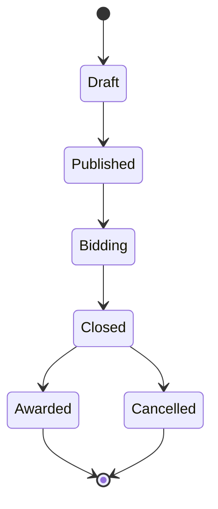
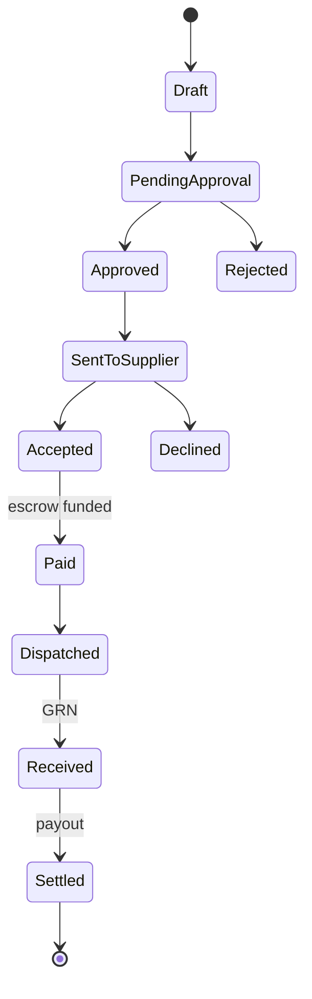

# REST API

## Principles
- Versioned base path: `/v1`
- Three route groups: `/v1/buyer`, `/v1/supplier`, `/v1/admin`
- OpenAPI 3.1 contract is the single source of truth
- OAuth 2.0 / OIDC with JWT access tokens; the token carries organisation, portal and role
- Rate limiting at the API gateway
- Long-running work (BOM parsing, RFQ broadcast, settlement) runs async through the queue; the API returns a job ID

## Example endpoints

### Buyer
| Method | Path | Purpose |
|---|---|---|
| GET | `/v1/buyer/catalog/search` | Parametric catalog search |
| POST | `/v1/buyer/rfqs` | Create RFQ |
| POST | `/v1/buyer/rfqs/{id}/bom-upload` | Upload BOM file to an RFQ |
| POST | `/v1/buyer/rfqs/{id}/publish` | Broadcast RFQ to suppliers |
| GET | `/v1/buyer/rfqs/{id}/bids` | Bid comparison data |
| POST | `/v1/buyer/bids/{id}/counter-offers` | Send counter-offer |
| POST | `/v1/buyer/pos` | Create PO from awarded bid |
| POST | `/v1/buyer/pos/{id}/approve` | Approve PO (MFA required) |
| POST | `/v1/buyer/pos/{id}/grn` | Confirm goods receipt |

### Supplier
| Method | Path | Purpose |
|---|---|---|
| PUT | `/v1/supplier/products/bulk` | Bulk catalog upload/update |
| GET | `/v1/supplier/rfqs` | RFQ inbox |
| POST | `/v1/supplier/rfqs/{id}/bids` | Submit bid |
| POST | `/v1/supplier/pos/{id}/accept` | Accept PO |
| POST | `/v1/supplier/pos/{id}/dispatch` | Add dispatch and shipment details |
| GET | `/v1/supplier/settlements` | Payouts and ledger |

### Admin
| Method | Path | Purpose |
|---|---|---|
| GET | `/v1/admin/kyb/queue` | KYB review queue |
| POST | `/v1/admin/kyb/{orgId}/decision` | Approve / reject / request info |
| PATCH | `/v1/admin/organisations/{orgId}` | Suspend or reactivate account |
| PUT | `/v1/admin/commission-rules` | Update commission rules |
| POST | `/v1/admin/settlements/run` | Start settlement run |
| GET | `/v1/admin/analytics/gmv` | GMV analytics |

## State machines

### RFQ

### Purchase order

Every state change is written to the audit log with user, time and reason. The exact states should be confirmed in the Discovery phase.
