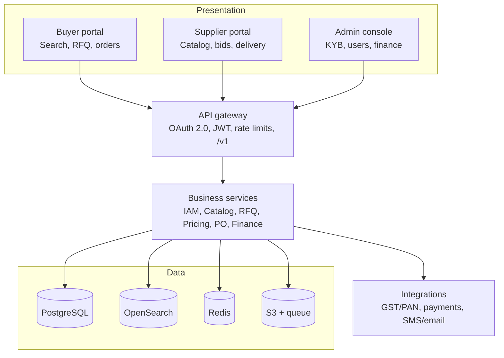

# Architecture

Decision: **three separate portals** on one shared REST API.

## Overview

## Five tiers (from the blueprint)

| Tier | Technology |
|---|---|
| 1. Presentation | Buyer, Supplier and Admin web (React/Next.js) + mobile apps (Flutter or React Native) |
| 2. API gateway | AWS API Gateway / Kong, OAuth 2.0 / OIDC, JWT, rate limiting, OpenAPI 3.1 |
| 3. Business logic | NestJS or Spring Boot modular domains (IAM, Catalog, RFQ, Pricing, PO, Finance) |
| 4. Data and messaging | PostgreSQL 16+, OpenSearch, Redis 7+, AWS S3, SQS/SNS or RabbitMQ |
| 5. Cloud and security | Multi-AZ containers (ECS/EKS), Terraform IaC, WAF, CDN, Prometheus/Grafana |

## Design choices

### Three separate front-ends
- Each portal is its own web app on its own domain, for example `buyer.example.in`, `supplier.example.in`, `admin.example.in`.
- All three live in **one monorepo** and share a design system, an API client and type definitions **(suggestion)**.
- Each portal can be released and scaled on its own.

### Isolated admin console (suggestion)
- Separate login client with MFA always on.
- Reachable only from office network or VPN (IP allowlist).
- Every admin action is written to the audit log.

### One REST API with three route groups
- `/v1/buyer/...`, `/v1/supplier/...`, `/v1/admin/...`
- Each group checks that the token belongs to the right portal, organisation and role.
- Contract defined in OpenAPI 3.1. Details in [API.md](API.md).

### Business services as a modular monolith (suggestion)
- The blueprint says "modular domains". One deployable backend with clear module borders is simpler for a 20-week project.
- A module can be split into its own service later if load or team size requires it.
- RFQ and PO status changes follow fixed state machines with audit logging.

### Data and messaging
| Component | Use |
|---|---|
| PostgreSQL | Main data. Tenant ID on every row and row-level security, so one company never sees another company's data. |
| OpenSearch | Catalog search (P95 ≤ 150 ms target). |
| Redis | Sessions, caching, rate-limit counters. |
| S3 | KYB documents, invoices, BOM files. |
| Queue (SQS/SNS or RabbitMQ) | Background work: RFQ broadcast, notifications, search indexing, settlement jobs. |

### Integrations
- GSTIN and PAN verification services
- Payment gateway / bank partner for escrow (nodal account) and payouts
- SMS and email providers (WhatsApp to be confirmed)
- Logistics tracking (to be confirmed)

### Hosting and data location (suggestion)
- Host in an Indian cloud region (for example AWS Mumbai).
- RBI rules require payment data to be stored in India for payment system operators. Confirm with the payment partner.
